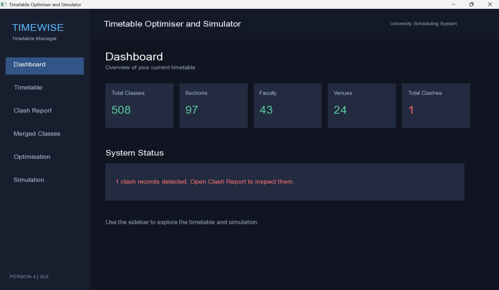
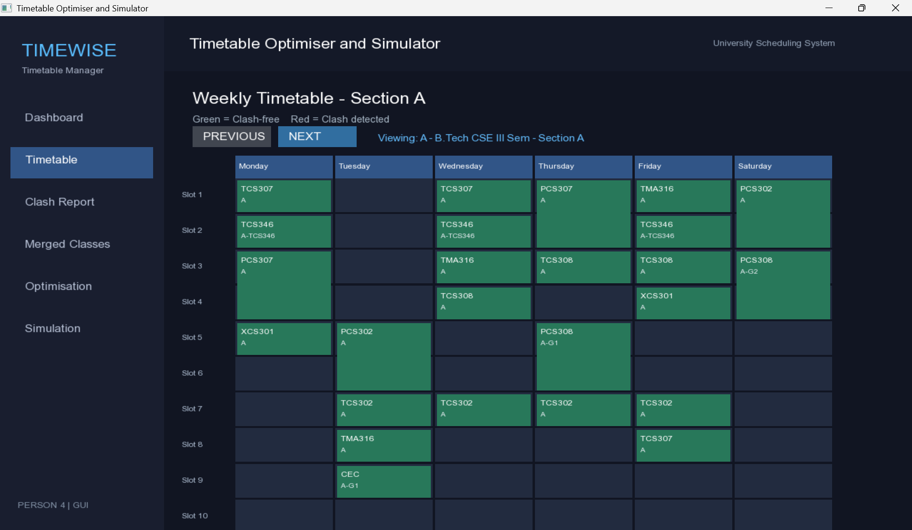
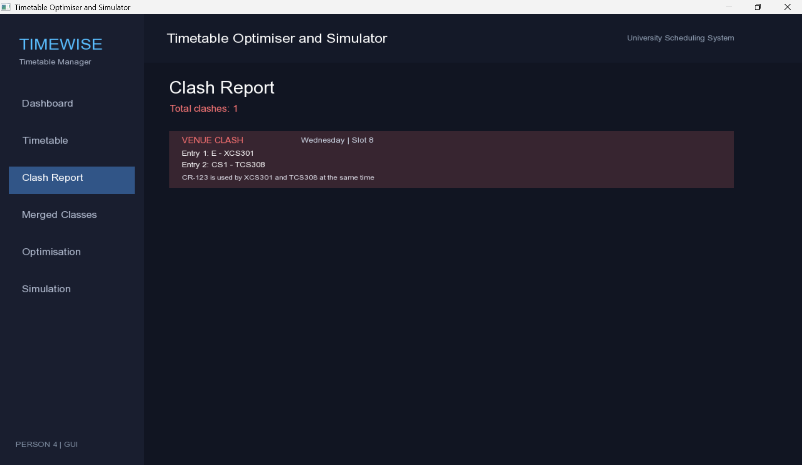
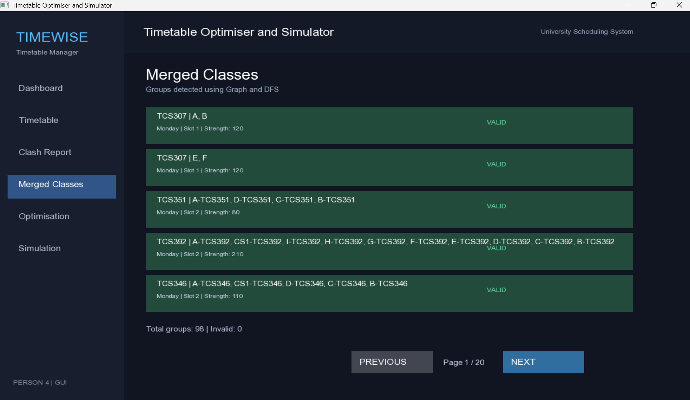
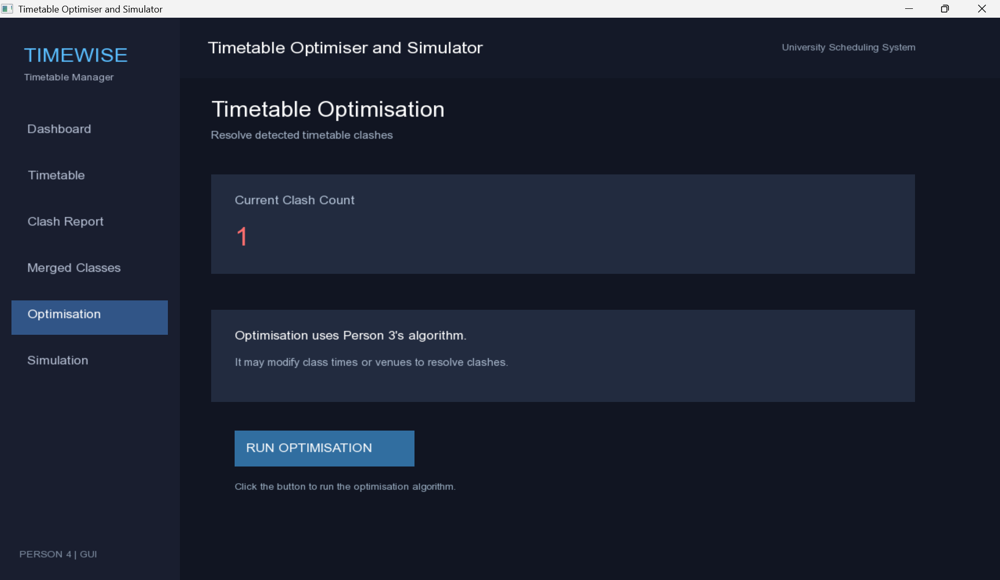
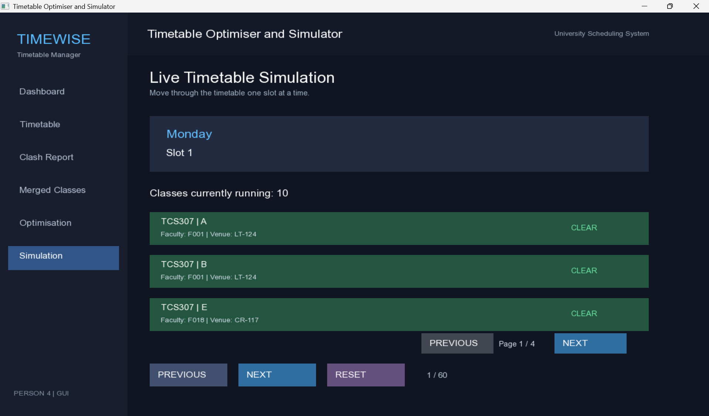

# TIMEWISE – Timetable Optimiser and Simulator

## About the Project

TIMEWISE is a C++ based Timetable Optimiser and Simulator developed as a college Project-Based Learning (PBL) project.

The application loads existing timetable data, detects scheduling clashes, identifies merged classes, and provides a graphical interface to visualise and simulate timetable activities.

## Features

- **Timetable Visualisation:** View weekly timetables section-wise.
- **Clash Detection:** Identify section, faculty, and venue clashes.
- **Merged Class Detection:** Identify classes shared by multiple sections using graph traversal.
- **Optimisation:** Apply timetable optimisation to reduce scheduling clashes.
- **Simulation:** Simulate timetable activities slot by slot.
- **Multithreading:** Uses C++ threads and mutexes for concurrent processing.
- **Graphical Interface:** Interactive GUI developed using SFML.

## Technologies Used

- C++
- SFML 3
- Graphs and BFS/DFS
- Linked Lists
- Multithreading (`std::thread`, `std::mutex`)
- CSV File Handling

## Project Structure

- `main.cpp` – Application entry point
- `modules/file_handling/` – CSV loading and data structures
- `modules/merged_classes/` – Merged class detection
- `modules/clash_detection/` – Clash detection and optimisation
- `modules/simulation/` – Timetable simulation and SFML GUI
- `data/` – Input CSV files and configuration
- `assets/` – GUI assets

## Running the Application

### For users

1. Download `Timewise-Release.zip` from the project's release/distribution package.
2. Extract the ZIP file.
3. Open the `Timewise-Release` folder.
4. Double-click `timetable.exe`.

No separate SFML installation or C++ compiler is required.

### For developers

The project can be compiled using a C++17-compatible compiler, SFML 3, and the required runtime libraries.

## Team Contributions

- File Handling and Data Management
- Merged Class Detection
- Clash Detection and Optimisation
- Timetable Simulation and GUI

## Project Status

Completed – College PBL Project.
## Screenshots

### 1. Dashboard

### 2. Section-wise Timetable

### 3. Clash Report

### 4. Merged Classes

### 5. Optimisation

### 6. Simulation
